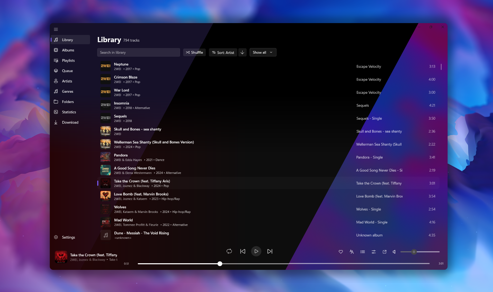

<div align="center">
  &nbsp;&nbsp;&nbsp;&nbsp;&nbsp;&nbsp;
  <h1>🎵 Resona</h1>
  <p><b>A modern Windows local music player designed for seamless library management, music downloading, auto-tagging, lyrics & cover fetching, AI playlist prompts, an equalizer, EN/FR support & more.</b></p>
  </div>



---

## ✨ Features

* 🎨 **Modern Design:** Beautiful WinUI 3 interface with support for 3 backdrop materials: Solid Color, Acrylic, and Mica.
* 🎧 **Bit-perfect Playback:** Uses NAudio (with an option to activate WASAPI Exclusive mode to bypass the Windows mixer for pure, unaltered sound).
* 📥 **Online Search & Download:** Search for music online and download tracks directly from the app into your library.
* 🔍 **Auto-Tagging:** Automatically identifies unknown tracks using acoustic fingerprinting (Chromaprint/fpcalc) to fetch accurate metadata (artist, title) from MusicBrainz.
* 🖼️ **Cover Art Fetching:** Automatically retrieves high-quality covers online.
* 🖼️ **Mini Player:** A compact, always-on-top mini player mode for controlling playback while you work.
* 🔊 **Normalization:** LUFS-based loudness analysis for a consistent perceived volume between tracks.
* 🎤 **Synchronized Lyrics:** Automatically fetches and caches synchronized lyrics via [LRCLib](https://lrclib.net), complete with a built-in translation option.
* 📖 **Artist Biographies:** Automatically fetches and displays artist biographies and information online.
* 🎛️ **Audio Processing:** Built-in 10-band graphic equalizer with presets to fine-tune your audio experience, and seamless crossfading between tracks.
* 📝 **Playlist Management:** Full support for M3U and M3U8 import/export.
* 🎮 **Discord Rich Presence:** Automatically showcase the track you are currently listening to on your Discord profile.
* 🤖 **AI DJ:** Provides prompts to AI models to generate smart playlists, suggest tracks, and offer deep insights into your music collection.
* 🌍 **Language:** Available in English and French. The interface auto-adapts to your OS language.

---

## 🗺️ To-Do List

Here is a big list of features and ideas I'd like to add to Resona. It is simply everything that comes to my mind, so I might not do all of it, and the order doesn't mean anything.

> **Note:** A checked item means it is already implemented internally and will be released in the next update.

<details>
<summary><b>Click to see what's planned</b></summary>

<br>

- [ ] Make the direct setup install from the app not require choosing an install location (it just downloads with a progress indicator and installs right away)
- [ ] Improve the color transitions between tracks in the normal view, and in all display modes improve the transition between tracks for the text and other elements (a smooth animation, not a flicker)
- [ ] Allow pure white in the color picker (as a gradient)
- [ ] Add an option so the app's theme grain isn't static
- [ ] Stream your music to a friend (a full synchronized listening system with music sent in both directions, the ability to send a notification to a friend who has Resona open, etc.)
- [x] Fix the occasional audio crackling, especially when changing tracks (potentially fixed, but requires extensive testing to verify)
- [ ] Add a selection menu when long-pressing the repeat button
- [ ] Improve security
- [x] Add the missing English translations
- [ ] Make a promo video for the app
- [x] Make the equalizer in the large central cover mode more faithful in how it represents the sound being played

</details>

---

## ⚠️ Disclaimer

This application was fully coded by AI. Since no other audio player on the market currently offers this blend of modern design, and all these handy features, this AI-generated solution fills the gap.

> [!NOTE]
> The day a human developer creates a similar open-source application with equivalent or superior quality, development will be stopped to prioritize human creation.

---

## 🔒 Security & Permissions

Since this is AI-generated code, transparency is key:

* **No Administrative Privileges:** This application explicitly runs with standard user permissions (`asInvoker`). It does not require, nor will it ever ask for, Administrator privileges to run.
* **UAC Safety Indicator:** If the application ever prompts you with a Windows UAC (User Account Control) warning asking for admin rights, close it immediately—that means the binary has been altered or compromised.

---

## 🛠️ Built With

* **C# / .NET 10**
* **WinUI 3 (Windows App SDK)**
* **NAudio** - Core audio playback engine
* **TagLibSharp** - Metadata extraction
* **SQLite** - Local library caching

---

## 🚀 How to Build and Run

1. Open `Resona.csproj` (or the solution file) in **Visual Studio**.
2. Ensure you have the **.NET Desktop Development** workload and **Windows App SDK** component installed.
3. NuGet packages will restore automatically.
4. Select the target platform (e.g., `x64`).
5. Press **F5** to build and launch!

---

## 📁 Cache & Application Data Locations

Resona stores its configuration, library cache, and downloaded assets inside your Windows user local directory.

* Main Application Directory:
```
%LOCALAPPDATA%\Resona\
```
*(Equivalent to: `C:\Users\<YourUsername>\AppData\Local\Resona\`)*

Inside this folder, you will find:
- `library_cache.db`: The SQLite database that allows instantaneous app launches. It caches your library's audio metadata, custom user playlists, and all fetched synchronized lyrics to avoid redundant network requests.
- `Covers\`: A directory containing all the cached album art. Resona generates unique album hashes to ensure only one image is saved per album (instead of one per track), saving significant disk space.
- `settings.json`: Your saved preferences, UI states, and configuration (language, theme, equalizer presets, etc.).
- `ai_backup.json`: Backup data for AI-generated playlists and insights.
- `backups\`: Automatic safety backups (`before-import-*.zip`) created before each import; the 5 latest are kept.
- `PlaylistCovers\`: Custom playlist covers restored from an imported backup.
- `fpcalc\`: Contains the Chromaprint fingerprinting executable used for the auto-tagging feature.
- `logs\`: Contains `resona.log`, the error log. It can be viewed, copied or cleared from the Settings page.
---

## 🗑️ Uninstall

**If you used the installer:** uninstall Resona from the Windows **Settings > Apps > Installed apps** list. Your data (library cache, settings, covers) is kept, see the last step below to remove it too.

**If you used the portable zip:**

1. Exit Resona (right-click the tray icon → **Quit** or close the app).
2. Delete the application folder containing the `.exe` file.

In both cases, to also remove your data (cache, settings, logs), delete this folder:
   - `%LOCALAPPDATA%\Resona`
