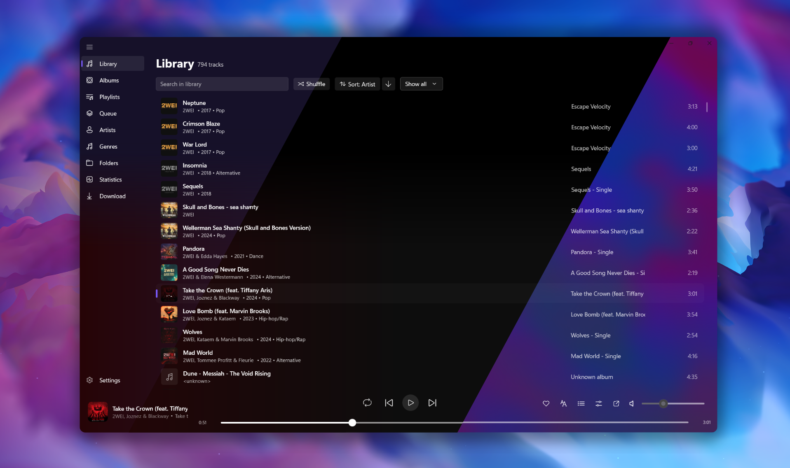

<div align="center">
  &nbsp;&nbsp;&nbsp;&nbsp;&nbsp;&nbsp;
  <h1>🎵 Resona</h1>
  <p><b>A modern Windows local music player designed for seamless library management, music downloading, auto-tagging, lyrics & cover fetching, AI playlist prompts, an equalizer, EN/FR support & more.</b></p>
  </div>



---

## ✨ Features

* 🎨 **Modern Design:** Beautiful WinUI 3 interface with support for 3 backdrop materials: Solid Color, Acrylic, and Mica.
* 🎧 **Bit-perfect Playback:** Uses NAudio (with an option to activate WASAPI Exclusive mode to bypass the Windows mixer for pure, unaltered sound).
* 🎛️ **Audio Processing:** Built-in 10-band graphic equalizer with presets to fine-tune your audio experience, and seamless crossfading between tracks.
* 🖼️ **Mini Player:** A compact, always-on-top mini player mode for controlling playback while you work.
* 🔊 **Normalization:** ReplayGain-style RMS/peak volume analysis. Gain is applied only during playback, ensuring your original files are never modified.
* 🎤 **Synchronized Lyrics:** Automatically fetches and caches synchronized lyrics via [LRCLib](https://lrclib.net), complete with a built-in translation option.
* 🖼️ **Cover Art Fetching:** Automatically retrieves high-quality covers online.
* 📖 **Artist Biographies:** Automatically fetches and displays artist biographies and information directly from Wikipedia.
* 🔍 **Auto-Tagging:** Automatically identifies unknown tracks using acoustic fingerprinting (Chromaprint/fpcalc) to fetch accurate metadata (artist, title) from MusicBrainz.
* 📝 **Playlist Management:** Full support for M3U and M3U8 import/export.
* 🎮 **Discord Rich Presence:** Automatically showcase the track you are currently listening to on your Discord profile.
* 🤖 **AI DJ:** Provides prompts to AI models to generate smart playlists, suggest tracks, and offer deep insights into your music collection.
* 🌍 **Language:** Available in English and French. The interface auto-adapts to your OS language.

---

## 🗺️ To-Do List

Here is a big list of features and ideas I'd like to add to Resona. It is simply everything that comes to my mind, so I might not do all of it, and the order doesn't mean anything.

> **Note:** A checked item means it is already implemented internally and will be released in the next update.

<details>
<summary><b>Click to see what's planned</b></summary>

<br>

#### 🎧 Player & Playback
- [ ] Use all the available space for the playback bar when the text (title, album, artist) is long, with the small cover to its left in the player
- [ ] Check the alignment of the elements in the player
- [ ] Sound wave / equalizer animation (optional and toggleable, for example in the large central cover view)
- [ ] Keyboard shortcut to skip 5 seconds
- [ ] Weighted shuffle: avoid replaying recent tracks (favor favorites?)
- [ ] Smart silence skipping at the start and end of tracks
- [ ] Volume ducking when another app plays a sound
- [ ] Transition animation between two tracks
- [ ] Light DJ mode: two decks with manual crossfade and tempo adjustment
- [ ] Power-saving mode?
- [ ] Interaction sound design (UI sounds, just for fun)

#### 📚 Library & Playlists
- [ ] Smart playlists with dynamic rules: "added this month", "never played", "genre = X and year > 2010", "most played"...
- [ ] Folder watching (`FileSystemWatcher`) to add or remove tracks without rescanning (to be checked)
- [ ] Playlist folders to group playlists into categories
- [ ] Playlist downloading
- [ ] Import playlists from other services through an exported file (Spotify CSV or other), with fuzzy matching against the local library
- [ ] More info columns in the track lists
- [ ] Library quality check: tracks without cover, corrupted files, inconsistent tags... with quick suggested fixes
- [ ] Broken path repair: when a file has been moved, offer to find it again by fingerprint or by name in the watched folders
- [ ] Mood analysis: sort tracks by energy, tempo or vibe, from metadata or a local calculation (BPM, spectrum)
- [ ] "Discovery" mode: similar artist suggestions
- [ ] Never-played reminder: a discreet "You've never played this track" suggestion
- [ ] Right-click context menu: open file location

#### 🎤 Lyrics
- [ ] Manual lyrics editing, with a sync offset adjustment for synchronized lyrics
- [ ] Additional fallback lyrics source(s)

#### 🎨 Themes & Interface
- [ ] Color theme animations that react to the sound
- [x] Collapsible sections in the Settings page, so it is less overwhelming now that there are so many options

#### 🌐 Sharing & Integrations
- [ ] Richer Discord Rich Presence: progress bar, real cover art, etc.
- [ ] Year in review: most played tracks, charts and more, animated and exportable as an image (designed to shine on New Year's Day)
- [ ] "Now listening" share card: generated image with the cover, title and current lyrics
- [ ] Playlist export as a web page or an image to share, with covers and track list
- [ ] File associations: set Resona as the default player and open a double-clicked audio file in the current queue
- [ ] "Open with Resona" Explorer menu for a folder or a selection

#### 🛠️ App & Maintenance
- [ ] Full import/export of settings and library (playlists, ratings, statistics), in addition to `ai_backup.json`
- [ ] Automatic update of yt-dlp and fpcalc, with version checking
- [x] Release notes shown in the app after an update, with a "See what's new" button
- [x] Optional installer (`Setup.exe`), for those who want a clean install, in addition to the portable zip (an MSIX package would require a code-signing certificate)

</details>

---

## ⚠️ Disclaimer

This application was fully coded by AI. Since no other audio player on the market currently offers this blend of modern design, and all these handy features, this AI-generated solution fills the gap.

> [!NOTE]
> The day a human developer creates a similar open-source application with equivalent or superior quality, development will be stopped to prioritize human creation.

---

## 🔒 Security & Permissions

Since this is AI-generated code, transparency is key:

* **No Administrative Privileges:** This application explicitly runs with standard user permissions (`asInvoker`). It does not require, nor will it ever ask for, Administrator privileges to run.
* **UAC Safety Indicator:** If the application ever prompts you with a Windows UAC (User Account Control) warning asking for admin rights, close it immediately—that means the binary has been altered or compromised.

---

## 🛠️ Built With

* **C# / .NET 10**
* **WinUI 3 (Windows App SDK)**
* **NAudio** - Core audio playback engine
* **TagLibSharp** - Metadata extraction
* **SQLite** - Local library caching

---

## 🚀 How to Build and Run

1. Open `Resona.csproj` (or the solution file) in **Visual Studio**.
2. Ensure you have the **.NET Desktop Development** workload and **Windows App SDK** component installed.
3. NuGet packages will restore automatically.
4. Select the target platform (e.g., `x64`).
5. Press **F5** to build and launch!

---

## 📁 Cache & Application Data Locations

Resona stores its configuration, library cache, and downloaded assets inside your Windows user local directory.

* Main Application Directory:
```
%LOCALAPPDATA%\Resona\
```
*(Equivalent to: `C:\Users\<YourUsername>\AppData\Local\Resona\`)*

Inside this folder, you will find:
- `library_cache.db`: The SQLite database that allows instantaneous app launches. It caches your library's audio metadata, custom user playlists, and all fetched synchronized lyrics to avoid redundant network requests.
- `Covers\`: A directory containing all the cached album art. Resona generates unique album hashes to ensure only one image is saved per album (instead of one per track), saving significant disk space.
- `settings.json`: Your saved preferences, UI states, and configuration (language, theme, equalizer presets, etc.).
- `ai_backup.json`: Backup data for AI-generated playlists and insights.
- `fpcalc\`: Contains the Chromaprint fingerprinting executable used for the auto-tagging feature.
- `logs\`: Contains `resona.log`, the error log. It can be viewed, copied or cleared from the Settings page.
---

## 🗑️ Uninstall

**If you used the installer:** uninstall Resona from the Windows **Settings > Apps > Installed apps** list. Your data (library cache, settings, covers) is kept, see the last step below to remove it too.

**If you used the portable zip:**

1. Exit Resona (right-click the tray icon → **Quit** or close the app).
2. Delete the application folder containing the `.exe` file.

In both cases, to also remove your data (cache, settings, logs), delete this folder:
   - `%LOCALAPPDATA%\Resona`
